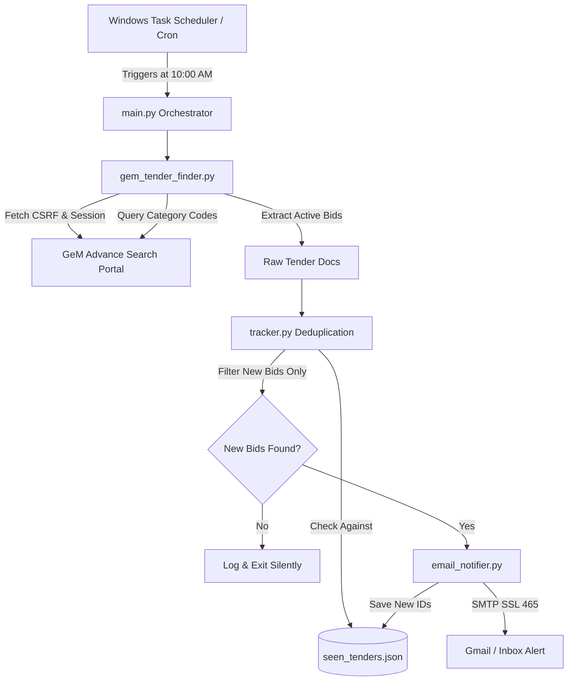

# 🏛️ GeM Tender Finder & Automated Email Alert System

An automated monitor and notification service for the **Government e-Marketplace (GeM)** portal (`https://bidplus.gem.gov.in/advance-search`). 

It periodically checks for active government tenders across user-defined product categories, prevents duplicate notifications with a persistent state tracker, and dispatches rich HTML email alerts directly to your inbox.

---

## 🌟 Key Features

- **Reverse-Engineered Search Engine**: Direct API communication with GeM's internal Solr/AJAX endpoints without heavy browser automation (Selenium/Puppeteer), making it ultra-fast and lightweight.
- **Dynamic Category Mapping**: Automatically extracts and resolves category codes from GeM's internal registry of over 14,000+ government procurement categories.
- **Smart Deduplication**: Retains tender IDs and bid numbers in a persistent store (`seen_tenders.json`), ensuring you are **never alerted twice** for the same tender.
- **Rich HTML Email Notifications**: Generates styled email cards containing Bid Number, Quantity, Department/Ministry, Deadline, and 1-click **Download Bid Document** buttons.
- **Silent Daily Automation**: Pre-configured with Windows Task Scheduler to run daily with zero black command prompt windows, catching up automatically if the laptop was turned on after scheduled hours.

---

## 🏗️ System Architecture



---

## 📁 Repository Structure

```
├── gem_tender_finder.py    # Core scraper & GeM API integration
├── tracker.py              # State manager & duplicate filter
├── email_notifier.py       # HTML email builder & SMTP sender
├── main.py                 # Daily orchestrator entry point
├── config.example.json     # Configuration template (credentials & categories)
├── run_daily.bat           # Batch launcher for automated execution
├── run_silent.vbs          # VBScript wrapper for windowless background execution
├── requirements.txt        # Python dependencies
└── .gitignore              # Protects secrets & logs from GitHub
```

---

## 🚀 Setup & Installation

### 1. Clone the Repository
```bash
git clone https://github.com/your-username/gem-tender-finder.git
cd gem-tender-finder
```

### 2. Install Dependencies
```bash
pip install -r requirements.txt
```

### 3. Configure Credentials & Categories
Copy the configuration template:
```bash
cp config.example.json config.json
```
Edit `config.json`:
```json
{
  "email": {
    "sender_email": "your_email@gmail.com",
    "app_password": "your_16_char_google_app_password",
    "recipient_email": "recipient_email@gmail.com"
  },
  "watched_categories": [
    "Travis",
    "Veterinary Artificial Insemination Straws (low Absorption Type)",
    "Foreign Body (metal) Detector For Veterinary Use",
    "Cattle Lifting Machine"
  ]
}
```

> **Note**: For Gmail, generate a 16-character App Password at [myaccount.google.com/apppasswords](https://myaccount.google.com/apppasswords).

### 4. Run Manually
```bash
python main.py
```

---

## 🔒 Security & Privacy

* **Protected Credentials**: `config.json`, `seen_tenders.json`, and `run.log` are strictly excluded in `.gitignore` to prevent leaking email credentials or local states.
* **Non-Invasive**: Respects rate limits with lightweight requests matching standard browser interaction.

---

## 📄 License
MIT License. Built for monitoring public tender notices on the Government e-Marketplace (GeM).

